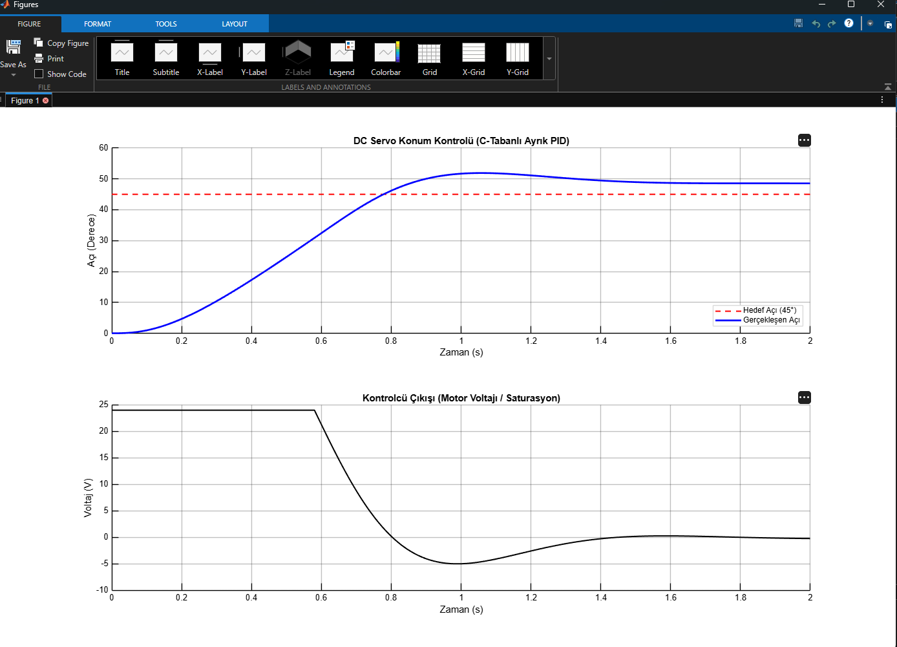
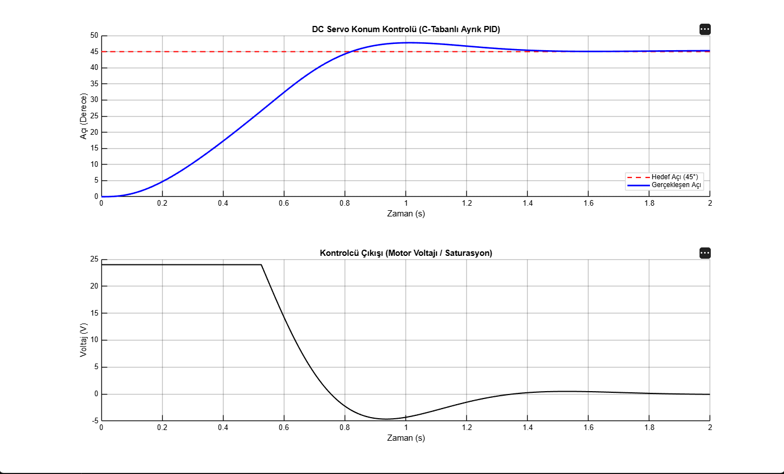

# DC Servo Actuator Position Control (Discrete PID in C & MATLAB)

A discrete-time (**1 kHz**) PID position controller and physical plant simulation for a DC servo actuator, developed in **C** with **MATLAB** post-processing and visualization. Designed to model realistic embedded actuator constraints including voltage saturation and integral windup mitigation.

## Key Engineering Features
- **Embedded-Ready C Architecture:** Modular `struct`-based PID implementation suitable for multi-axis MCU deployment (e.g., STM32 hardware timer interrupts).
- **Discrete-Time Execution:** Fixed-step numerical integration (**Euler method**) running at `Ts = 1 ms` (`1 kHz`).
- **Actuator Saturation:** Output voltage clamped to `±24V` to reflect real power-stage / driver limits.
- **Conditional Integration Anti-Windup:** Halts integral accumulation whenever the actuator is saturated, preventing excessive overshoot and slow recovery.
- **Toolbox-Independent MATLAB Analysis:** Custom script (`analyze_servo.m`) that parses telemetry logs (`servo_log.csv`) and computes Rise Time, Settling Time, Overshoot, and Steady-State Error without requiring Control System Toolbox.

---

## System Model & Parameters
The DC servo actuator is modeled as a coupled electromechanical system:

- **Electrical Dynamics:** `V = R*i + L*(di/dt) + K*w`
- **Mechanical Dynamics:** `J*(dw/dt) + B*w = K*i`
- **Kinematics:** `d(theta)/dt = w`

| Parameter | Symbol | Value | Unit |
| :--- | :---: | :---: | :--- |
| Armature Resistance | `R` | `1.0` | Ω |
| Armature Inductance | `L` | `0.05` | H |
| Rotor Inertia | `J` | `0.005` | kg·m² |
| Viscous Friction | `B` | `0.02` | N·m·s |
| Torque / Back-EMF Constant | `K` | `0.1` | N·m/A |
| Sampling Period | `DT` | `0.001` | s (1 kHz) |

---

## Simulation Results: Anti-Windup Impact

### 1. Before: Static Clamping under Saturation (Integral Windup)
During the initial `24V` saturation phase, static integral clamping failed to trigger before windup occurred, causing overshoot (~52°) and slow recovery toward the `45°` setpoint.



### 2. After: Conditional Integration Anti-Windup & Tuning (`Kp = 2.0, Ki = 0.05, Kd = 0.35`)
By pausing integration during `±24V` saturation and increasing derivative damping, the actuator tracks the `45°` reference smoothly, eliminates steady-state error, and settles cleanly around `1.45 s`.



---

## How to Run
1. Compile and run the C simulation to generate telemetry data (`servo_log.csv`):

```bash
gcc servo_pid.c -o servo_pid
./servo_pid
```

2. Open MATLAB in the project directory and run the visualization script:

```matlab
analyze_servo
```

## Future Improvements
- Porting the `PID_Compute` module to an **STM32** microcontroller using Hardware Timer Interrupts, Quadrature Encoder feedback, and PWM motor drive output.
- Adding a **Low-Pass Filter** to the derivative term (`Derivative-on-Measurement`) to suppress sensor noise.
